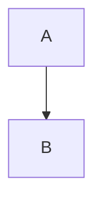

---
mermaid:
  size: 8
  subgraphs: side
  diagrams:
    museum:
      size: 7pt
      subgraphs: stack
      width: 4i
---



``` {#museum .mermaid}
flowchart LR
  C --> D
```

``` {#other .mermaid size=9 font=HR width=50%}
graph TD
  E --> F
```

``` {#bad .mermaid size=huge subgraphs=up font=H-1}
graph LR
  G --> H
```
